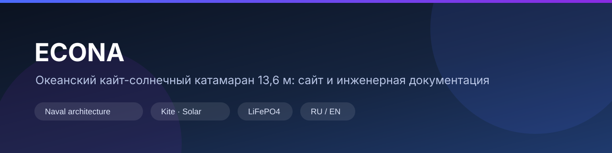
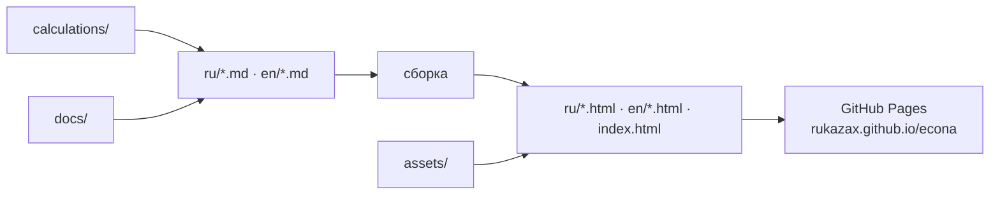
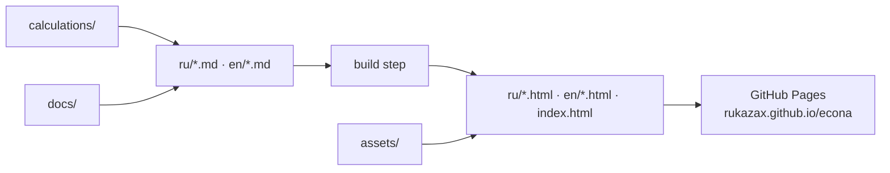

<div align="center">
  
</div>

# ECONA — океанский кайт-солнечно-электрический катамаран

**RU** · [English](#english)

[](https://github.com/rukazax)


> Океанский кайт-солнечный катамаран 13,6 м: публичный сайт и инженерная документация.

**Статус:** концепция / исследование · **Обновлено:** 27 октября 2026
**Сайт:** https://rukazax.github.io/econa/

ECONA — самостоятельный исследовательско-конструкторский проект океанского
кайт-солнечно-электрического катамарана. Концепция формируется на базе анализа современных
тенденций и развития технологий, а не как утверждённый проект для постройки.

## Содержание

| Раздел | О чём |
|---|---|
| [Коротко о проекте](#коротко-о-проекте) | ключевые параметры судна и границы открытости |
| [Документация](#документация) | страницы сайта и исходники Markdown |
| [Как устроен сайт](#как-устроен-сайт) | Markdown → HTML → GitHub Pages |
| [Структура репозитория](#структура-репозитория) | что где лежит |
| [Краткий итог](#краткий-итог) | что проверено и что не подтверждено |
| [Ссылки](#ссылки) | сайт, публикации, материалы |

## Коротко о проекте

| Параметр | Значение |
|---|---|
| Тип судна | океанский кайт-солнечно-электрический катамаран |
| Длина | 13,6 м |
| Стадия | концепция / исследование |
| Открытая документация | русский и английский |
| Расчёты | гидростатика сверена независимым методом |
| Пока не установлено | весовая ведомость, центр тяжести, общая прочность, мореходность |
| Закрыто by design | CAD-модели, расчётные входы, служебные данные |

## Документация

| Раздел | Сайт | Исходник Markdown |
|---|---|---|
| Описание проекта | [RU](https://rukazax.github.io/econa/ru/index.html) · [EN](https://rukazax.github.io/econa/en/index.html) | [RU](ru/index.md) · [EN](en/index.md) |
| Ход разработки | [RU](https://rukazax.github.io/econa/ru/development.html) · [EN](https://rukazax.github.io/econa/en/development.html) | [RU](ru/development.md) · [EN](en/development.md) |
| Результаты проверок и ограничения | [RU](https://rukazax.github.io/econa/ru/tests.html) · [EN](https://rukazax.github.io/econa/en/tests.html) | [RU](ru/tests.md) · [EN](en/tests.md) |
| Дальнейшие проверки | [RU](https://rukazax.github.io/econa/ru/roadmap.html) · [EN](https://rukazax.github.io/econa/en/roadmap.html) | [RU](ru/roadmap.md) · [EN](en/roadmap.md) |
| Границы публикации | [RU](https://rukazax.github.io/econa/ru/publication.html) · [EN](https://rukazax.github.io/econa/en/publication.html) | [RU](ru/publication.md) · [EN](en/publication.md) |
| Картинки и расчёты | [RU](https://rukazax.github.io/econa/ru/materials.html) · [EN](https://rukazax.github.io/econa/en/materials.html) | [RU](ru/materials.md) · [EN](en/materials.md) |

## Как устроен сайт

Markdown-исходники в `ru/` и `en/` — единственный источник правды; опубликованные HTML-страницы
в `ru/`, `en/` и корневой `index.html` собираются из них и раздаются через GitHub Pages.



## Структура репозитория

```
en/ ru/          документация (markdown-исходники + опубликованные html)
assets/          изображения, схемы, спецификации
calculations/    расчётные входы и результаты
docs/            инженерные заметки
index.html       стартовая страница проекта
project.yaml     метаданные проекта
sitemap.xml      карта сайта для поисковиков
```

## Краткий итог

Программный инженерный стенд восстановлен на Windows. Гидростатические вычисления сверены
независимым методом; результаты совпали в пределах численной точности. Это не доказывает
пригодность судна.

Окончательная весовая ведомость и центр тяжести не установлены, общая прочность не подтверждена.
Оценки динамической устойчивости, сопротивления и ходкости не завершены. Мореходные и
полномасштабные испытания не подтверждены.

В комплект возвращены картинки, схемы, спецификации, расчётные входы и результаты. CAD-модели,
секреты и служебные данные остаются приватными. Документация не является законченным проектом для
постройки; готовность к эксплуатации и сертификация не заявляются.

## Ссылки

[Проектный сайт](https://rukazax.github.io/econa/) · [Публикации](https://rukazax.github.io/econa/ru/publication.html) · [Материалы](https://rukazax.github.io/econa/ru/materials.html)

## English

ECONA — ocean-going kite–solar–electric catamaran, 13.6 m: public site and engineering docs.

**Status:** concept / research · **Updated:** 27 October 2026
**Website:** https://rukazax.github.io/econa/

ECONA is an independent research and design project for an ocean-going kite–solar–electric
catamaran. The concept is developed through analysis of current technology trends rather than
through an approved construction design.

### Quick facts

| Parameter | Value |
|---|---|
| Vessel type | ocean-going kite–solar–electric catamaran |
| Length | 13.6 m |
| Stage | concept / research |
| Public documentation | Russian and English |
| Calculations | hydrostatics cross-checked by an independent method |
| Not established yet | final weight statement, centre of gravity, structural strength, seaworthiness |
| Private by design | CAD models, calculation inputs, operational data |

### Documentation

| Section | Website | Markdown source |
|---|---|---|
| Project overview | [EN](https://rukazax.github.io/econa/en/index.html) · [RU](https://rukazax.github.io/econa/ru/index.html) | [EN](en/index.md) · [RU](ru/index.md) |
| Development progress | [EN](https://rukazax.github.io/econa/en/development.html) · [RU](https://rukazax.github.io/econa/ru/development.html) | [EN](en/development.md) · [RU](ru/development.md) |
| Check results and limitations | [EN](https://rukazax.github.io/econa/en/tests.html) · [RU](https://rukazax.github.io/econa/ru/tests.html) | [EN](en/tests.md) · [RU](ru/tests.md) |
| Further checks | [EN](https://rukazax.github.io/econa/en/roadmap.html) · [RU](https://rukazax.github.io/econa/ru/roadmap.html) | [EN](en/roadmap.md) · [RU](ru/roadmap.md) |
| Publication boundaries | [EN](https://rukazax.github.io/econa/en/publication.html) · [RU](https://rukazax.github.io/econa/ru/publication.html) | [EN](en/publication.md) · [RU](ru/publication.md) |
| Images and calculations | [EN](https://rukazax.github.io/econa/en/materials.html) · [RU](https://rukazax.github.io/econa/ru/materials.html) | [EN](en/materials.md) · [RU](ru/materials.md) |

### How the site is built

Markdown sources in `ru/` and `en/` are the single source of truth; the published HTML pages under
`ru/`, `en/` and the root `index.html` are generated from them and served by GitHub Pages.



### Repository layout

```
en/ ru/          documentation (markdown sources + published html)
assets/          images, diagrams, specifications
calculations/    calculation inputs and results
docs/            engineering notes
index.html       project landing page
project.yaml     project metadata
sitemap.xml      sitemap for search engines
```

### Summary

The software-based engineering test environment has been restored on Windows. Hydrostatic
calculations have been cross-checked by an independent method; the results agree within numerical
precision. This does not establish the vessel's fitness for service.

The final weight statement and centre of gravity have not been established, and overall structural
strength has not been validated. Assessments of dynamic stability, resistance and vessel
performance are incomplete. Sea trials and full-scale testing have not been confirmed.

Images, diagrams, specifications, calculation inputs and results have been restored. CAD models,
secrets and operational data remain private. This is not a completed design for construction;
operational readiness and certification are not claimed.

### Links

[Project website](https://rukazax.github.io/econa/) · [Publications](https://rukazax.github.io/econa/en/publication.html) · [Materials](https://rukazax.github.io/econa/en/materials.html)

---

#boat-design #catamaran #engineering #freecad #hydrostatics #kite #lifepo4 #naval-architecture #openfoam #sailing
