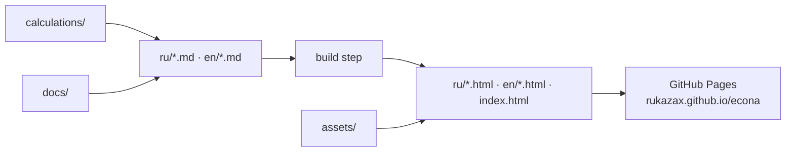

# ECONA — ocean-going kite–solar–electric catamaran

[Русский](README.ru.md) | **English**

**Status:** concept / research · **Updated:** 27 October 2026
**Website:** https://rukazax.github.io/econa/

ECONA is an independent research and design project for an ocean-going kite–solar–electric
catamaran. The concept is developed through analysis of current technology trends rather than
through an approved construction design.

## Quick facts

| Parameter | Value |
|---|---|
| Vessel type | ocean-going kite–solar–electric catamaran |
| Length | 13.6 m |
| Stage | concept / research |
| Public documentation | Russian and English |
| Calculations | hydrostatics cross-checked by an independent method |
| Not established yet | final weight statement, centre of gravity, structural strength, seaworthiness |
| Private by design | CAD models, calculation inputs, operational data |

## Documentation

| Section | Website | Markdown source |
|---|---|---|
| Project overview | [EN](https://rukazax.github.io/econa/en/index.html) · [RU](https://rukazax.github.io/econa/ru/index.html) | [EN](en/index.md) · [RU](ru/index.md) |
| Development progress | [EN](https://rukazax.github.io/econa/en/development.html) · [RU](https://rukazax.github.io/econa/ru/development.html) | [EN](en/development.md) · [RU](ru/development.md) |
| Check results and limitations | [EN](https://rukazax.github.io/econa/en/tests.html) · [RU](https://rukazax.github.io/econa/ru/tests.html) | [EN](en/tests.md) · [RU](ru/tests.md) |
| Further checks | [EN](https://rukazax.github.io/econa/en/roadmap.html) · [RU](https://rukazax.github.io/econa/ru/roadmap.html) | [EN](en/roadmap.md) · [RU](ru/roadmap.md) |
| Publication boundaries | [EN](https://rukazax.github.io/econa/en/publication.html) · [RU](https://rukazax.github.io/econa/ru/publication.html) | [EN](en/publication.md) · [RU](ru/publication.md) |
| Images and calculations | [EN](https://rukazax.github.io/econa/en/materials.html) · [RU](https://rukazax.github.io/econa/ru/materials.html) | [EN](en/materials.md) · [RU](ru/materials.md) |

## How the site is built

Markdown sources in `ru/` and `en/` are the single source of truth; the published HTML pages under
`ru/`, `en/` and the root `index.html` are generated from them and served by GitHub Pages.



## Repository layout

```
en/ ru/          documentation (markdown sources + published html)
assets/          images, diagrams, specifications
calculations/    calculation inputs and results
docs/            engineering notes
index.html       project landing page
project.yaml     project metadata
sitemap.xml      sitemap for search engines
```

## Summary

The software-based engineering test environment has been restored on Windows. Hydrostatic
calculations have been cross-checked by an independent method; the results agree within numerical
precision. This does not establish the vessel's fitness for service.

The final weight statement and centre of gravity have not been established, and overall structural
strength has not been validated. Assessments of dynamic stability, resistance and vessel
performance are incomplete. Sea trials and full-scale testing have not been confirmed.

Images, diagrams, specifications, calculation inputs and results have been restored. CAD models,
secrets and operational data remain private. This is not a completed design for construction;
operational readiness and certification are not claimed.

## Links

[Project website](https://rukazax.github.io/econa/) · [Publications](https://rukazax.github.io/econa/en/publication.html) · [Materials](https://rukazax.github.io/econa/en/materials.html)
