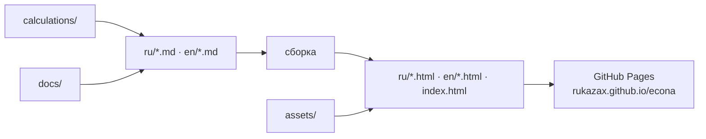

# ECONA — океанский кайт-солнечно-электрический катамаран

**Русский** | [English](README.md)

**Статус:** концепция / исследование · **Обновлено:** 27 октября 2026
**Сайт:** https://rukazax.github.io/econa/

ECONA — самостоятельный исследовательско-конструкторский проект океанского
кайт-солнечно-электрического катамарана. Концепция формируется на базе анализа современных
тенденций и развития технологий, а не как утверждённый проект для постройки.

## Коротко о проекте

| Параметр | Значение |
|---|---|
| Тип судна | океанский кайт-солнечно-электрический катамаран |
| Длина | 13,6 м |
| Стадия | концепция / исследование |
| Открытая документация | русский и английский |
| Расчёты | гидростатика сверена независимым методом |
| Пока не установлено | весовая ведомость, центр тяжести, общая прочность, мореходность |
| Закрыто by design | CAD-модели, расчётные входы, служебные данные |

## Документация

| Раздел | Сайт | Исходник Markdown |
|---|---|---|
| Описание проекта | [RU](https://rukazax.github.io/econa/ru/index.html) · [EN](https://rukazax.github.io/econa/en/index.html) | [RU](ru/index.md) · [EN](en/index.md) |
| Ход разработки | [RU](https://rukazax.github.io/econa/ru/development.html) · [EN](https://rukazax.github.io/econa/en/development.html) | [RU](ru/development.md) · [EN](en/development.md) |
| Результаты проверок и ограничения | [RU](https://rukazax.github.io/econa/ru/tests.html) · [EN](https://rukazax.github.io/econa/en/tests.html) | [RU](ru/tests.md) · [EN](en/tests.md) |
| Дальнейшие проверки | [RU](https://rukazax.github.io/econa/ru/roadmap.html) · [EN](https://rukazax.github.io/econa/en/roadmap.html) | [RU](ru/roadmap.md) · [EN](en/roadmap.md) |
| Границы публикации | [RU](https://rukazax.github.io/econa/ru/publication.html) · [EN](https://rukazax.github.io/econa/en/publication.html) | [RU](ru/publication.md) · [EN](en/publication.md) |
| Картинки и расчёты | [RU](https://rukazax.github.io/econa/ru/materials.html) · [EN](https://rukazax.github.io/econa/en/materials.html) | [RU](ru/materials.md) · [EN](en/materials.md) |

## Как устроен сайт

Markdown-исходники в `ru/` и `en/` — единственный источник правды; опубликованные HTML-страницы
в `ru/`, `en/` и корневой `index.html` собираются из них и раздаются через GitHub Pages.



## Структура репозитория

```
en/ ru/          документация (markdown-исходники + опубликованные html)
assets/          изображения, схемы, спецификации
calculations/    расчётные входы и результаты
docs/            инженерные заметки
index.html       стартовая страница проекта
project.yaml     метаданные проекта
sitemap.xml      карта сайта для поисковиков
```

## Краткий итог

Программный инженерный стенд восстановлен на Windows. Гидростатические вычисления сверены
независимым методом; результаты совпали в пределах численной точности. Это не доказывает
пригодность судна.

Окончательная весовая ведомость и центр тяжести не установлены, общая прочность не подтверждена.
Оценки динамической устойчивости, сопротивления и ходкости не завершены. Мореходные и
полномасштабные испытания не подтверждены.

В комплект возвращены картинки, схемы, спецификации, расчётные входы и результаты. CAD-модели,
секреты и служебные данные остаются приватными. Документация не является законченным проектом для
постройки; готовность к эксплуатации и сертификация не заявляются.

## Ссылки

[Проектный сайт](https://rukazax.github.io/econa/) · [Публикации](https://rukazax.github.io/econa/ru/publication.html) · [Материалы](https://rukazax.github.io/econa/ru/materials.html)
